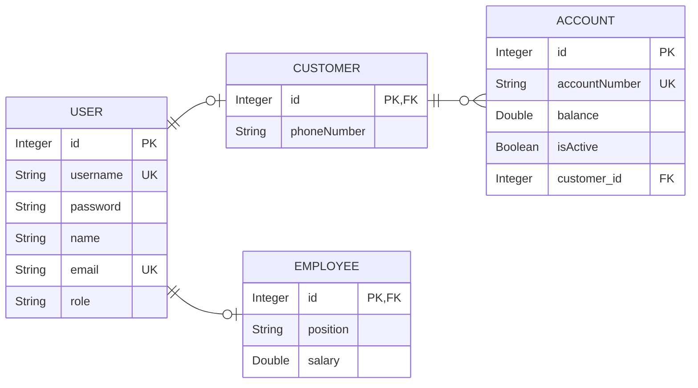

<div align="center">

# Bank Management System

### Secure banking REST API built with Spring Boot

A role-based backend for managing customers, employees and bank accounts, with deposits, withdrawals and transfers.

</div>

---

## Project Brief

The Bank Management System is a Spring Boot REST API with three roles: **ADMIN**, **EMPLOYEE** and **CUSTOMER**. Customers register themselves, open accounts and move money. Employees and admins activate or block accounts. Admins manage everything else.

Every endpoint is protected with Spring Security (HTTP Basic), and ownership rules are enforced in the services, so a customer can only touch their own data.

---

## Main Features

- Public customer registration; employees are created by an admin only.
- Role-based authorization on every endpoint.
- Ownership checks: a customer can only view, update and delete their own profile and accounts.
- Account lifecycle: create (inactive), activate, block, update, delete.
- Deposit, withdraw and transfer with validation (active account, positive amount, sufficient balance).
- Transactions: money operations are all-or-nothing (`@Transactional`).
- Cascade delete: deleting a customer removes the user and their accounts.
- Passwords stored with BCrypt.
- DTO-based validation and a global exception handler.

---

## Class Diagram



A user is either a customer or an employee, and a customer owns many accounts.

`Customer.id` and `Employee.id` share the primary key of their `User` (`@MapsId`).

---

## Roles and Permissions

| Action | Public | CUSTOMER | EMPLOYEE | ADMIN |
|---|:---:|:---:|:---:|:---:|
| Register as customer | yes | | | |
| Update / delete own customer profile | | yes | | yes (any) |
| Register / manage employees | | | | yes |
| View users and customers | | | | yes |
| Create an account | | yes | | |
| View an account | | own | yes | yes |
| View all accounts | | | yes | yes |
| Update / delete an account | | own | | yes |
| Activate / block an account | | | yes | yes |
| Deposit / withdraw / transfer | | own | | |
| View a customer's accounts | | own | yes | yes |

---

## Business Rules

- A new account is **inactive** until an employee or admin activates it.
- Account number format: `1234-5678-9012-3456`, unique.
- Deposit, withdraw and transfer require an **active** account and an amount **greater than 0**.
- Withdraw and transfer cannot exceed the balance.
- Transfer: the source account must belong to the caller, both accounts must be active, and they must differ.
- Blocking sets the account inactive; activating sets it active again. Doing either twice returns an error.
- Customer validation: username 4-10 characters, password at least 6, name 2-20, phone `05XXXXXXXX`.

---

## Endpoints

### Auth (`/api/v1/auth`)

| Method | Endpoint | Access | Description |
|---|---|---|---|
| GET | `/get-all` | ADMIN | All users |
| GET | `/get/{userId}` | ADMIN | One user |
| POST | `/logout` | Authenticated | Logout |

### Customer (`/api/v1/customer`)

| Method | Endpoint | Access | Description |
|---|---|---|---|
| POST | `/register` | Public | Register a customer |
| GET | `/get-all` | ADMIN | All customers |
| GET | `/get/{id}` | ADMIN | One customer |
| PUT | `/update/{id}` | Owner or ADMIN | Update customer and user data |
| DELETE | `/delete/{id}` | Owner or ADMIN | Delete customer, user and accounts |

### Employee (`/api/v1/employee`) - ADMIN only

| Method | Endpoint | Description |
|---|---|---|
| POST | `/register` | Register an employee |
| GET | `/get-all` | All employees |
| GET | `/get/{id}` | One employee |
| PUT | `/update/{id}` | Update an employee |
| DELETE | `/delete/{id}` | Delete an employee |

### Account (`/api/v1/account`)

| Method | Endpoint | Access | Description |
|---|---|---|---|
| GET | `/get-all` | ADMIN, EMPLOYEE | All accounts |
| GET | `/get/{id}` | CUSTOMER (own), EMPLOYEE, ADMIN | One account |
| POST | `/add` | CUSTOMER | Create an account |
| PUT | `/update/{id}` | CUSTOMER (own), ADMIN | Change the account number |
| DELETE | `/delete/{id}` | CUSTOMER (own), ADMIN | Delete an account |
| PUT | `/activate/{id}` | EMPLOYEE, ADMIN | Activate an account |
| PUT | `/block/{id}` | EMPLOYEE, ADMIN | Block an account |
| PUT | `/deposit/{accountId}/{amount}` | CUSTOMER (own) | Deposit |
| PUT | `/withdraw/{accountId}/{amount}` | CUSTOMER (own) | Withdraw |
| PUT | `/transfer/{fromId}/{toId}/{amount}` | CUSTOMER (source owner) | Transfer between accounts |
| GET | `/customer/{customerId}` | CUSTOMER (own), EMPLOYEE, ADMIN | A customer's accounts |

---

## Tech Stack

- Java, Spring Boot, Spring Data JPA (Hibernate)
- Spring Security (HTTP Basic, BCrypt)
- MySQL / MariaDB
- Lombok, Jakarta Validation
- Postman for testing

---

## Getting Started

1. Create the database:

   ```sql
   CREATE DATABASE BankSystem;
   ```

2. Set your database username and password in `src/main/resources/application.properties`.

3. Run the application. Tables are created automatically (`ddl-auto=create-drop`, so data is reset on every restart).

4. An admin is seeded on startup:

   | Username | Password |
   |---|---|
   | `admin` | `Admin@123` |

5. Import the Postman collections and run the folders in order on a fresh database:
   - `BankSystem.postman_collection.json` - registration, users, customers, employees, accounts.
   - `BankSystem_Remaining.postman_collection.json` - activate, block, deposit, withdraw, transfer, accounts by customer.

---

<div align="center">

**Author:** Mohammed Turki

</div>
